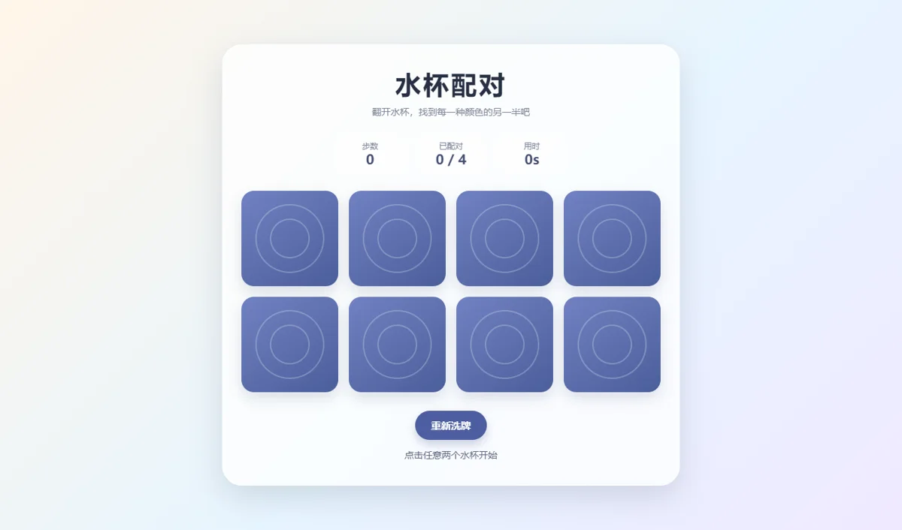
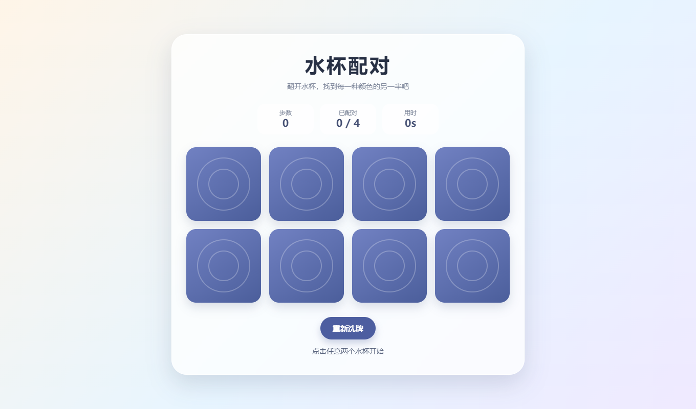
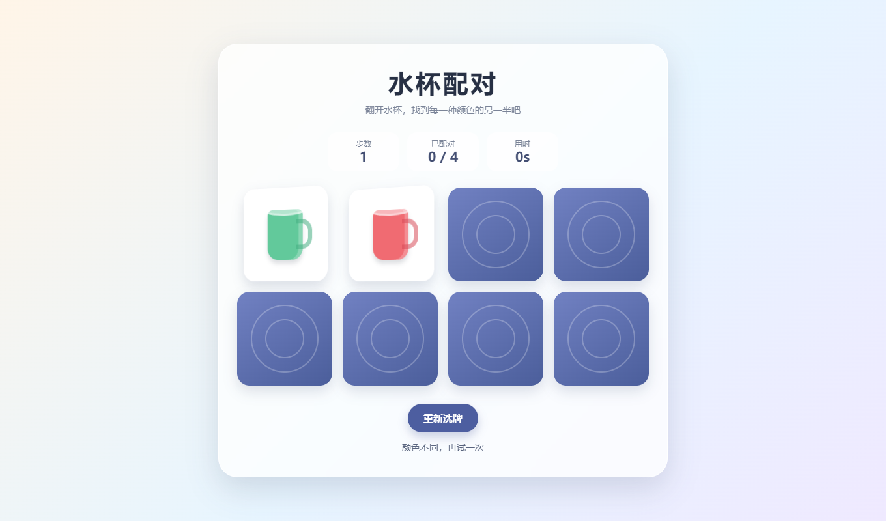

# 水杯配对

一局八只杯子，翻开两只查看颜色，记录尝试次数，直至四对全部找到。独立单文件，无服务器状态。

## 实际界面巡览



上图由两张本次实际运行画面的截屏轮换组成，不是连续操作录像。

| 新一局 | 翻开一对杯子 |
| --- | --- |
|  |  |

## 可以做什么

- 翻开杯子并比较颜色
- 统计尝试次数与完成进度
- 重新洗牌开始一局

## 本地运行

```sh
python -m http.server 8000 --bind 127.0.0.1
```

在浏览器打开 `http://127.0.0.1:8000/`。只监听本机；不执行部署。

## 实测与范围

翻开两个杯子，核对移动计数从 0 增加。

这是浏览器记忆配对游戏，不是数学推导中每次反馈匹配总数的排列问题。

[手机宽度实机截屏（390 px）](showcase/03-mobile.png) · [授权范围](LICENSE) · [来源与署名](NOTICE.md)
